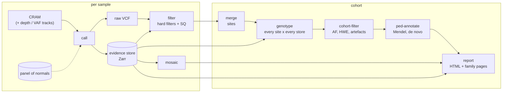
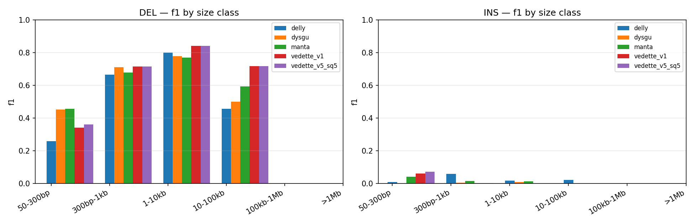

# Vedette

**Vedette** is a germline copy-number variant caller (deletions and duplications) for
short-read whole-genome sequencing, built for **specificity** at cohort scale.

It combines read depth, discordant pairs, split reads (including "hidden" splits recovered
from soft clips), insert-size shifts and B-allele frequency per sample, filters the calls
with a calibrated machine-learning score, then re-genotypes every cohort site in every
sample and reads the result through the pedigree: inheritance, de novo candidates,
chromosomal mosaics, sex-chromosome karyotypes, and an HTML report with one interactive
page per family.

- **One CRAM pass per sample.** Calling writes a compact, schema-versioned
  [Zarr](https://zarr.dev) *evidence store* (~100 MB per genome). Filtering, cohort
  re-genotyping, mosaic scanning, karyotyping and QC all read the store and never touch
  the CRAM again.
- **Tiered filtering.** Hard filters, then a calibrated gradient-boosting score (`SQ`,
  phred-scaled probability that the call is real), then cohort metrics (recurrence,
  Hardy-Weinberg, carrier fraction, copy-number consistency), all sex-aware on chrX/chrY.
- **Built for families.** Mendelian consistency, transmission and de novo quality on
  trios, with X- and Y-linked inheritance, and guards against technically atypical genomes
  (carrier load, de novo excess, wavy coverage).
- **Scales from one genome to thousands**, through a Nextflow wrapper on SLURM; the
  cohort stages use every allocated core.

Status: **v1.14.0**, in production
at the GHFC lab (Institut Pasteur) on cohorts of 300 to 2,700 genomes. Not on PyPI or
Bioconda; install from source (below).

## Contents

- [Installation](#installation)
- [Quick start](#quick-start)
- [How it works](#how-it-works)
  - [Pipeline overview](#pipeline-overview)
  - [1. Calling (`vedette call`)](#1-calling-vedette-call)
  - [2. Filtering (`vedette filter`)](#2-filtering-vedette-filter)
  - [3. Merging (`vedette merge`)](#3-merging-vedette-merge)
  - [4. Re-genotyping (`vedette genotype`)](#4-re-genotyping-vedette-genotype)
  - [5. Cohort metrics (`vedette cohort-filter`)](#5-cohort-metrics-vedette-cohort-filter)
  - [6. Pedigree annotation (`vedette ped-annotate`)](#6-pedigree-annotation-vedette-ped-annotate)
  - [7. Chromosomal mosaics (`vedette mosaic`)](#7-chromosomal-mosaics-vedette-mosaic)
  - [8. Translocations, inversions and terminal losses (`vedette bnd`)](#8-translocations-inversions-and-terminal-losses-vedette-bnd)
  - [9. Sex-chromosome karyotype](#9-sex-chromosome-karyotype)
  - [10. Report and family pages (`vedette report`)](#10-report-and-family-pages-vedette-report)
- [Building your own panel of normals](#building-your-own-panel-of-normals)
- [Filter models](#filter-models)
- [Benchmark](#benchmark)
- [Commands](#commands)
- [Outputs and file formats](#outputs-and-file-formats)
- [Configuration](#configuration)
- [Parallelism and resources](#parallelism-and-resources)
- [Known limitations](#known-limitations)
- [Development](#development)
- [Citation and license](#citation-and-license)

## Installation

Vedette is a Python package (src layout, CLI `vedette` built with
[typer](https://typer.tiangolo.com)). It runs on Python 3.12 (`pyproject.toml` accepts
≥ 3.11) with pysam, numpy, scipy, numba, zarr, scikit-learn, typer and intervaltree;
pyBigWig is needed to read the population-coverage track, matplotlib for the report and
benchmark figures. The conda/micromamba environment in `containers/environment.yml` pins
all of them:

```bash
git clone https://github.com/darkxander/vedette.git
cd vedette
micromamba create -n vedette -f containers/environment.yml
micromamba run -n vedette pip install -e .            # or -e ".[bigwig,dev]"
micromamba run -n vedette vedette --help
```

A dedicated environment is recommended: the CLI and the Nextflow wrapper call the
`vedette` executable of that environment (`params.vedette_bin`).

Containers are provided: `containers/Dockerfile` (Docker,
`docker build -f containers/Dockerfile -t vedette:latest .`) and `containers/vedette.def`
(Apptainer/Singularity).

Training and benchmarking (not needed to call) additionally use
[Truvari](https://github.com/ACEnglish/truvari): `pip install truvari`.

### Reference data

Vedette is set up for **GRCh38** with `chr`-prefixed contigs (calling covers chr1-22, chrX,
chrY by default; the pseudo-autosomal coordinates used for inheritance are GRCh38's). You
need:

| resource | used by | notes |
|---|---|---|
| reference FASTA + `.fai` | call, merge, label, bench | required |
| exclusion BED | call (bin mask), filter | e.g. the CNVnator 100 bp GRCh38 exclusion list |
| segmental-duplication BED | filter, report | e.g. UCSC genomicSuperDups |
| low-complexity / self-chain BED | filter, report | |
| population-coverage SD bigWig | filter (feature `popcov_stdev`) | optional, e.g. ClinSV's `popCovStdev.bw` |
| Ensembl GFF (bgzip + tabix) | report (gene column) | optional |
| GeneTrek NDD gene table (TSV) | report (impact score) | optional, not distributed here |

None of these files, and no panel of normals, ship with the repository. GC content and N
fraction per bin are computed from the FASTA on first use and cached in the `--resources`
directory.

## Quick start

### One sample

```bash
# 1. call: CRAM -> raw calls (VCF) + evidence store
vedette call --sample S1 --cram S1.cram --snv-vcf S1.snv.vcf.gz \
    --config my_site.toml --resources vedette_resources/ \
    --pon my_pon.zarr --out-dir out/S1

# 2. filter: hard filters + calibrated SQ score
vedette filter out/S1/S1.vedette.vcf.gz --store out/S1/S1.evidence.zarr \
    --model-dir models/v5n --config my_site.toml --out out/S1/S1.filtered.vcf.gz

# 3. optional: chromosomal-scale mosaic segments, from the store alone
vedette mosaic out/S1/S1.evidence.zarr --out out/S1/S1.mosaic.tsv
```

On a run (`samples/<S>/` directories), `vedette bnd --run-dir out --fasta ref.fa` adds the
translocation and inversion junctions and the mechanism of terminal losses
([section 8](#8-translocations-inversions-and-terminal-losses-vedette-bnd)); the Nextflow
workflow runs it before the report (`--bnd false` to skip; it needs the `filter` step in
the same run).

- `my_site.toml` holds your reference paths (see [Configuration](#configuration)); the
  default threshold, SQ ≥ 5, is the operating point of the shipped model.
- `--pon` is optional but is what production runs use; you have to build the panel
  yourself ([Building your own panel of normals](#building-your-own-panel-of-normals)).
- B-allele frequency comes from `--snv-vcf` (single-sample VCF of biallelic SNVs with
  `FORMAT/AD`; PASS or unfiltered sites with depth ≥ 8, `FORMAT/DP` when given, else the sum
  of `AD`; no QUAL threshold) or `--vaf-bedgraph`. Without either, the BAF channel is
  empty: the HMM, the genotyper, the large-duplication rescue, the mosaic scan and the
  karyotype all lose their allelic evidence.
- Smoke test: add `--contig chr20` to `call` (about a minute on the fast path).

**Fast path.** If your pipeline already produces a 1 kb depth track and a per-site VAF
track, pass them with `--depth-bedgraph` / `--vaf-bedgraph` alongside the CRAM: depth and
BAF are then read from the tracks, and the CRAM is scanned for junction evidence only.
Without a CRAM, calling is depth + BAF only. Our production tracks are
`mosdepth -n -m -x -Q 40 --by 1000` (median depth per 1 kb bin, bgzipped and tabix-indexed)
and DeepVariant 1.9 sites with `FILTER=PASS`, `QUAL ≥ 30`, `DP ≥ 10`, written as a
tabix-indexed bedgraph `chrom  pos0  pos0+1  vaf`.

The `QUAL ≥ 30` of that track is a mistake for BAF: DeepVariant 1.9 gives many true
heterozygotes a lower QUAL. On chr20, an ordinary 39× genome keeps 44k of its 56k PASS
heterozygotes, and old or deep genomes (≥ 60×) as few as 1.6k of 32k; the ones dropped have a
median VAF of 0.50. `vedette baf` rewrites the BAF of existing stores from the DeepVariant VCF
(PASS biallelic SNVs, `DP ≥ 10`, no QUAL threshold) in about a minute per genome, without the
CRAM; the previous arrays stay as `<contig>/baf_track/`:

```bash
vedette baf runs/C1/samples/S1/S1.evidence.zarr --vcf S1.deepvariant.vcf.gz
vedette baf --manifest stores_vcfs.tsv --jobs 8     # store<TAB>vcf per line
```

Only the stores change. The BAF features of the per-sample calls (`BAFN`, `BAFDEV`, used by
the filter model) were computed at calling time and stay as they are; the karyotype, mosaic
scan and tensors read the new BAF. Cohort genotyping (`vedette genotype`) keeps reading the
original one (`baf_track`) unless `[genotype] rewritten_baf = true`: its likelihood counts every
het inside a deletion as a mismap, and in paralogous loci the rewritten BAF has ~20 hets per kb,
which turned carriers of common deletions into 0/0 and made de novo calls (chr12 of
dataset_paper: 3,025 de novo with the original BAF in production, 3,653 with the rewritten one). `vedette regenotype
S1.vedette.vcf.gz --store S1.evidence.zarr --out S1.regeno.vcf.gz` recomputes the store-derived
fields of the calls (GT, GQ, CN, CNQ, RD, BAFN, BAFDEV; junction support and source kept) for
the filter to be re-run; on stores whose BAF was not rewritten it reproduces the calling-time
values (GT, CN, BAFN identical on 44,895 calls of two genomes, GQ on all but 2).

### A cohort with Nextflow

The Nextflow wrapper in `workflows/nextflow/` runs every step on SLURM from a sample
manifest and a 6-column pedigree.

1. **Manifest.** A TSV with header
   `sample_id  cram  batch  sex  depth_bedgraph  vaf_bedgraph` (the last two may be empty).
   `vedette manifest discover` builds one by walking a samples directory, but only knows
   the GHFC layout (`--layout ghfc`); elsewhere write it yourself and check it with
   `vedette manifest validate`.
2. **Pedigree.** `family_id  sample_id  father_id  mother_id  sex  phenotype`, header
   optional, missing parents as `0`, `-9`, `NA`, `.` or empty, sex `1`/`2`/`0` (`1.0`/`2.0`
   are accepted).
3. **Site parameters.** Edit `workflows/nextflow/nextflow.config` (or pass `--param value`
   or `-params-file`): `vedette_bin`, `vedette_config`, `resources_dir`, `fasta`, `pon`,
   `model_dir`, and for the report `genes_gff`, `ndd_tsv`, `clingen_genes`, `clingen_regions`, `segdup_bed`, `lcr_bed`,
   `low_quality_prefixes`. The values in the repository point to the GHFC cluster and must
   be replaced; the SLURM profiles (`slurm`, `slurm_common`) name GHFC partitions.
4. **Run.**

```bash
cd workflows/nextflow
nextflow run main.nf -profile slurm \
    --manifest cohort.manifest.tsv --pedigree cohort.pedigree.tsv \
    --outdir results/cohort --cohort_name "My cohort" \
    --steps call,filter,merge,genotype,cohort,ped,report \
    --family_events true --events_pass_only true -resume
```

`launch_driver.sh` wraps the same command for a detached driver (`setsid nohup … &`) with
the Java and Nextflow versions pinned for the GHFC cluster; adapt its paths before use.
A `local` profile runs everything on one machine for smoke tests (`--contigs chr20`).

`--steps` must be a prefix of `call → filter → merge → genotype → cohort → ped → report`
(default: `call,filter`), or start at `filter` with `--calls_dir` pointing at published
calls (`<dir>/<S>/<S>.vedette.vcf.gz` + `<S>.evidence.zarr`): the re-filter path after a
model update; those are symlinked into `<outdir>/samples/<S>/`, where the report reads
the stores. `ped` requires `--pedigree`; `report` runs after `ped`. Other parameters:
`--known_sites` (reference cohort VCF for `CommonRef`), `--artifact_bed`,
`--family_workspaces` (per-family VCF subsets, default `true`; disable on 1000+-family
cohorts), `--family_events`, `--events_pass_only` (needed at cohort scale), `--mosaic`
(default `true`), `--publish_mode` (`link` by default; `copy` across filesystems).

A plain SLURM-array alternative for call + filter is in `workflows/slurm/`.

## How it works

### Pipeline overview



Architecture rules that hold throughout:

- the **evidence store is the contract** between `call` and every later stage: downstream
  stages never re-read a CRAM, and any change to the store's arrays or attributes bumps
  its schema version;
- the **feature schema** of the filter is append-only, and each trained model pins its
  hash;
- **copy ratio is normalized to the diploid autosomal median**: a normal autosome sits at
  1.0, a male chrX at 0.5; copy-number states are absolute integers;
- positions are **0-based half-open** internally; conversion happens only at VCF output;
- **calling is permissive** (depth-only calls are kept), and specificity is the job of the
  filter stage: hard filters, then the calibrated score, then cohort metrics.

### 1. Calling (`vedette call`)

**Evidence extraction.** With a CRAM, one coordinate-sorted pass per contig (contigs in
parallel worker processes) collects, from primary non-duplicate reads:

- binned depth (read-start counts per 100 bp bin, MAPQ ≥ 1) when no depth track is given;
- discordant pairs (MAPQ ≥ 10), classed DEL-like (insert beyond μ + 4σ), DUP-like
  (everted), INV-like or inter-contig, after fitting the insert-size model on 1 M proper
  pairs;
- soft clips ≥ 15 bp with mean base quality ≥ 10, with their sequences;
- CIGAR deletions ≥ 30 bp (operations closer than 30 bp within a read are summed): the
  main evidence for 50-300 bp deletions, which aligners align through rather than clip;
- a local insert-size track (mean template length per 100 bp bin).

With the fast path, depth comes from the 1 kb bedgraph instead. BAF comes from the VAF
track or the SNV VCF.

**Bin mask and GC correction.** Bins with more than 10 % N, or more than half covered by
the exclusion BED, are masked. Depth is GC-corrected with a multiplicative factor per
2 %-GC stratum (median depth of the stratum against the global median, fitted on unmasked
autosomal bins), then divided by the median corrected autosomal depth: the **copy ratio**,
1.0 for two copies.

**Sex inference and karyotype.** Without a panel of normals, the median ratio of chrX and
chrY sets the baseline ploidy: a sample is male if chrX < 0.75 or chrY > 0.25. Men get
ploidy 1 on chrX and chrY, women 2 on chrX and 0 on chrY (not called). With `--pon`, the
baseline comes from the measured sex-chromosome karyotype instead (section 9: copy number
on the panel's sex-informative bins, X heterozygosity, BAF): XXY gets chrX 2 / chrY 1, XXX
chrX 3, XYY chrY 2, X0 chrX 1 / chrY 0; an intermediate or unreadable karyotype keeps the
threshold rule. The threshold rule read an XXY as a man and an XXX as a woman, and their
extra X came out as ~170-240 fragmented chrX calls while a deletion of one X was missed.
**Whole autosomes** at 1 or 3 copies get their own baseline too: ≥ 85 % of the
chromosome's 1 Mb windows (≥ 20 informative, uncovered gaps skipped) at the same integer
copy number, confirmed by the BAF (median |BAF − 0.5| > 0.12 over ≥ 200 heterozygous sites
for three copies; a heterozygous-site rate < 0.15 × the genome's for one). A trisomy 12
went from 128 fragment DUPs to 13 PASS DUPs on chr12, and its deletions came back (93 ->
118 PASS DEL), a trisomy 21 lost its 15 fragments of 0.3 to 11 Mb; on 87 genomes the check found the two known trisomies (12 and 21) and
nothing else. A depth gain without the BAF of three copies (a wave, a GC bias) or over
part of a chromosome keeps the diploid baseline; the trisomy itself is reported by the
mosaic scan (constitutional anomalies). The ploidy map, `karyotype` and `aneuploidies`
are written to the store, where re-genotyping, the panel of normals and the cohort stages
find them.

**Wave QC.** Some libraries carry megabase-scale coverage oscillations that survive GC
correction. Vedette measures them per genome: the copy ratio is cut into 10 Mb windows
(half-overlapping), each window is linearly detrended, and the score is the fraction of its
spectral energy at periods ≥ 200 kb; median over windows per contig, mean over contigs.
The warning threshold, **0.128**, was calibrated on 592 genomes against an independent
wave detector (AUC 0.946; `docs/wave_qc_validation.md`, in French). Wavy genomes fragment
the HMM, flood the split-read recovery and carry more false calls; the score is stored,
shown in the report and used by its guards. It is measured on the depth as sequenced,
before any panel of normals (every threshold is calibrated on it); with a panel, the
corrected depth is scored too (`wave_score_pon`).

**Panel-of-normals normalization (`--pon`).** Each bin's ratio is divided by the panel's
per-bin median (sex-stratified profile on chrX/chrY: the male profile for one X, the
female one for two or more) and brought back to that profile's level (0.5 on the male
chrX/chrY, 1.0 on the female chrX and the autosomes); the HMM then reads the result
against the contig's own ploidy, so an XXX chrX at 1.5 is three copies, not a gain. Bins where the panel is too variable
(MAD > 0.30 × median) or systematically low (median < 0.25 × baseline) are masked. If the
panel carries SVD components, the sample's projection onto them is removed as well. This
divides out residual systematic bias the GC model cannot see (mappability, reference
artefacts, batch effects, coverage waves). See
[Building your own panel of normals](#building-your-own-panel-of-normals).

**CN-HMM segmentation.** Per contig, an HMM with integer states CN 0-5 (5 = "≥ 5") runs on
the copy ratio:

- depth emission: Gaussian around CN/2 with variance growing with the mean, σ fitted per
  sample from bins near the diploid level;
- BAF emission (weight 1.0, `segment.baf_weight`): beta-mixture likelihood of clear
  heterozygous sites (VAF 0.15-0.85) under each CN (CN 2 at 1/2, CN 3 at 1/3 and 2/3, …;
  a clear heterozygous site contradicts CN ≤ 1), capped at 3 sites' weight per bin;
- masked bins are uninformative (equal emission), so segments run through gaps;
- transition probability 1e-8 per bin; Viterbi path, forward-backward posteriors.

Non-baseline segments become depth candidates, tagged `NoEvidence` (< 3 bins), `MaxN`
(> 70 % masked) or `LowPosterior` (mean posterior < 0.90) without being dropped.

**Junction evidence.**

- *Discordant pairs* are clustered (≥ 3 pairs) into imprecise junctions, refined to base
  pairs by split-read pileups (≥ 2 clipped reads within 5 bp).
- *CIGAR deletions* shared by ≥ 3 reads form junctions of their own.
- *Hidden split reads.* A soft-clipped read is half of a split read whose other half the
  aligner dropped. The longest clips of each pileup (≥ 20 bp, up to 3) are realigned
  against the local reference (± 2 kb) with a fit alignment written in numba (no external
  aligner); concordant hits (≥ 2, identity ≥ 0.85) give a base-pair junction, and the
  direction of the hit gives the type: forward → deletion, backward → tandem duplication.
  This recovers tandem duplications **smaller than the insert**, which produce no everted
  pairs. Junction micro-homology is measured on the reference (`HOMLEN`). The number of
  alignments per contig is capped (150,000) so that wavy genomes cannot run for days.
- *Insert-size shift.* Pairs spanning a deletion shorter than the insert are individually
  concordant but collectively stretched. Runs of ≥ 3 bins whose local mean insert has
  z ≥ 3.5 (≥ 10 spanning pairs) become `SOURCE=INSERT` deletion candidates with wide
  confidence intervals, pre-genotyped heterozygous.

**Reconciliation.** A depth segment matched by a junction of the same type (within
max(2 bins, 10 % of the size)) takes the junction's coordinates (`SOURCE=BOTH`, precise
when both ends have split reads). A junction alone is kept up to 10 kb
(`SOURCE=JUNCTION`); a duplication junction made of everted pairs only, without split-read
or CIGAR support, is discarded (on HG002, 37,689 false for 74 true). A segment alone stays
an imprecise `SOURCE=DEPTH` call. Junctions longer than 20 Mb are ignored; the minimum
reported size is 50 bp.

**Genotyping.** Every candidate is genotyped by one likelihood combining the copy ratio
(Gaussian, depth weight capped so megabase events do not saturate), junction-read counts
(negative binomial, overdispersion 0.75) and BAF (beta mixture over the expected allelic
ratios). It returns GT, GQ, the
most likely integer CN and its posterior (CNQ). On a haploid contig the genotypes are 0
or 1 copy of the variant allele.

**Evidence store.** Everything later stages need is written to `<S>.evidence.zarr`
(schema 0.5; 0.1-0.4 are still read):

```
/                          attrs: schema_version, sample, reference_id, bin_size,
                                  mean_depth, depth_mad, coverage, ploidy{contig},
                                  karyotype, karyotype_note, aneuploidies{contig},
                                  insert_mu, insert_sigma, insert_n_pairs, depth_source,
                                  wave_score, wave_by_contig, wave_score_pon, pon, ...
<contig>/depth_raw         float32[n_bins]   raw binned depth
<contig>/depth_corr        float32[n_bins]   GC- (and PoN-) corrected depth
<contig>/mask              bool[n_bins]      bins excluded from depth modelling
<contig>/baf/{pos,vaf,dp}                    per-site B-allele fraction (attr baf_source)
<contig>/baf_track/{pos,vaf,dp}              the BAF before `vedette baf` rewrote it
<contig>/pe/{pos1,pos2,mate_tid,orient,mapq} discordant pairs
<contig>/sr/{pos,side,mapq,cliplen,seq_*}    soft clips and their sequences
<contig>/cig/{pos,svlen}                     large CIGAR deletions
<contig>/ins/{sum,n}                         binned insert-size track
```

Size: 80-120 MB per 35× genome at 100 bp bins, about 1 TB for 10,000 genomes.

### 2. Filtering (`vedette filter`)

For each raw call, `filter` computes 30 features from the VCF record and the evidence
store (`src/vedette/filter/schema.py`): size, type, precision and source; depth
(call/flank and call/chromosome depth ratios, residual against the called CN, coefficient
of variation, fraction of consistent bins, flank asymmetry); junction support (PE, SR,
CIGAR, insert-shift z and pairs, support relative to coverage, micro-homology); BAF
(number of heterozygous sites, mean |VAF − 0.5|); context (segmental duplication,
low-complexity, exclusion overlap, population coverage SD); genotyper internals (GQ, CN,
CNQ); and the genome's wave score.

**Tier 1, hard filters** (transparent, never silently dropping a record):

| FILTER | rule |
|---|---|
| `MinSize` | shorter than 50 bp |
| `MaxN` | > 30 % in the exclusion mask, or > 70 % masked bins |
| `LowMap` | > 70 % segmental duplication with no split-read or CIGAR support |
| `NoEvidence` | no PE, SR, CIGAR or insert-shift support and < 3 informative bins |
| `CohortArtifact` | > 50 % inside a recurrent-artefact BED (`--artifact-bed`) |

Tags set at calling (`LowPosterior`, …) are carried over.

**Tier 2, calibrated score.** With `--model-dir`, two gradient-boosting models (DEL, DUP)
score every call in one vectorized pass. `SQ = −10·log10(1 − P(true))`, capped at 99, where
P(true) is isotonic-calibrated: SQ 5 is P ≈ 0.68, SQ 13 is P ≈ 0.95. Calls below
`filter.low_sq_threshold` get `LowSQ`. Scoring refuses a model whose feature-schema hash
does not match the build (a model trained on a prefix of the current schema is accepted).

**Overrides.** The model has almost never seen very large events, and scores them badly.
Two rules keep them PASS whatever their SQ, recorded in `INFO/SQ_OVERRIDE`:

- `LARGE_DEL_DEPTH`: deletion ≥ 200 kb whose depth relative to its chromosome is < 0.75,
  with < 50 % masked bins. Without it, half of the 1-10 Mb deletions of a family cohort
  were rejected, causal terminal deletions included; on every labelled call available, it
  retains 131/131 true and no false.
- `LARGE_DUP_BAF`: duplication ≥ 100 kb at CN ≥ 3 whose heterozygous sites show the
  allelic imbalance of a gain (≥ 30 sites, mean |VAF − 0.5| ≥ 0.12), with < 50 % segmental
  duplication and < 50 % masked bins. Depth alone cannot vouch for a gain (coverage waves
  mimic them); allelic balance can. A trisomy 21, two 15q11-q13 duplications, a 7q11.23
  duplication, a trisomy 13 and a trisomy X were `LowSQ` before it; it rescues one
  duplication per genome in median.

`--features-out` also writes the feature matrix (TSV), the input of model training.

### 3. Merging (`vedette merge`)

Filtered calls of all samples are clustered into cohort sites, DEL and DUP separately,
contig by contig. A call joins a cluster only if it is compatible with the cluster's
running **centroid** (median start and end of its members), never by transitive chaining,
so that nearby distinct events are not fused:

- precise calls: reciprocal overlap ≥ 0.8 and both ends within max(150 bp, min(10 % of the
  size, 1 kb));
- imprecise calls: reciprocal overlap ≥ 0.7 and both ends within max(2 kb, 20 % of the size).

Only carrier records that PASS (or carry only `LowPosterior`) nominate sites. **Recurrence
rescue:** a call rejected by `LowSQ` alone with SQ ≥ 1 (`--rescue-min-sq`) joins clusters
as a sub-threshold member; a cluster with no passing member is still emitted, as
`RESCUE=RECURRENT`, when ≥ 2 distinct samples carry it (`--rescue-min-samples`) with summed
best SQ ≥ 8 (`--rescue-total-sq`). A familial CNV in a hard region that scores SQ ~2 in
every carrier would otherwise disappear. The output is a sites-only VCF with `NMEMBERS`,
`NSAMPLES`, `SPREAD`, `PRECISE_FRAC`, `SQMAX`, `SQMEAN`.

### 4. Re-genotyping (`vedette genotype`)

Every site is genotyped in every sample from its evidence store alone, with the same
likelihood as at calling: copy ratio over the site, discordant pairs and split reads
supporting that adjacency (split reads within 100 bp of the breakpoints, pairs within
μ + 3σ), CIGAR deletions and BAF. Carriers missed at the single-sample stage are recovered
without reading any CRAM; chrY is skipped in women. One job per sample, I/O-light
(~100 MB per store), so it parallelizes widely.

### 5. Cohort metrics (`vedette cohort-filter`)

The per-sample tables are assembled into a multi-sample VCF (`GT:GQ:CN:RD:PE:SR`) with
`AC`, `AN`, `AF`, `NS`, `NCARRIER`, `CARRIER_FRAC`, `HWE_P`, `GTR_DISC`, `CN_DISC`, and
five site filters:

| FILTER | rule (defaults) |
|---|---|
| `CohortArtifact` | AF > 0.02 (`--artifact-af`) and founder HWE p < 1e-6; or ≥ 3 nominating samples and re-genotyping finds > 50 % fewer carriers than were nominated; or, with `--known-sites`, AF > 0.02 here and the matching reference site is `CohortArtifact` (INFO `REF_ARTIFACT`; `--no-known-artifacts` to turn off): a small cohort has neither the power nor the stability of the founders' HWE test |
| `HighCarrierFrac` | carried by ≥ 0.85 of the genotyped samples (`--carrier-frac-max`, needs ≥ 4 samples): reference or mappability artefacts that HWE cannot see |
| `CNDiscordant` | ≥ 0.5 of the carriers (`--cn-discordant-frac`, ≥ 2 carriers) have a re-genotyped CN that contradicts the type: a DUP below, or a DEL above, the carrier's own baseline |
| `CommonRef` | with `--known-sites` (a reference cohort VCF, e.g. a large `cohort-filter` output), the matching site (same type, reciprocal overlap ≥ 0.5) is carried by ≥ 0.5 of that cohort (`--known-common-frac`); `REF_AF`, `REF_CARRIER_FRAC`, `REF_FILTER` are annotated whenever a match exists |
| `ChrYNoDepth` | chrY outside the PARs: shorter than one depth bin (1 kb), or fewer than half of the carriers have a CN that supports the type (a DUP above, a DEL below their baseline) |

HWE is the Wigginton exact test on the founders of the pedigree (on every sample without
one). Genotype discordance is **directional**: only "fewer carriers than nominations" is
suspicious; more carriers is re-genotyping doing its job.

**Sex chromosomes.** A man carries one copy of chrX and chrY (genotypes 0/0 or 1/1,
reference CN 1). Each sample's chrX ploidy is read from the copy number of its reference
genotypes on chrX (median of ≥ 10 sites below 1.5 → one X), i.e. from the store's ploidy,
not from the pedigree sex, which can be wrong. Then:

- HWE on chrX is tested on **female founders only**; on chrY there is no HWE test;
- `HighCarrierFrac` uses **each sex's carrier fraction**: pooled, a junction artefact
  carried by 96 % of the women and half of the men sat at 0.6-0.75 of the cohort, under
  the threshold;
- `CNDiscordant` is **ploidy-relative**: a man's CN 1 on chrX is his reference, not a
  deletion;
- on chrY outside the PARs, a site needs **copy-number support** (`ChrYNoDepth`): small
  junction-only calls in the Y repeats were carried by up to two thirds of the men at
  their baseline CN, and a son disagreed with his father in 40-54 % of the pairs carrying
  them (20 % on the deletions the CN supports). Below one depth bin the carriers' CN comes
  from the junctions: on the sites left, father/son discordance 34 % (DEL) and 86 % (DUP)
  under 1 kb, 10 % and 24 % above, so those sites are flagged too.

`vedette pon artifacts` turns a cohort VCF into a recurrent-artefact BED (founder AF ≥ 0.03
with HWE p ≤ 1e-6, or ≥ 3 nominators with discordance ≥ 0.5), which `filter --artifact-bed`
applies to later runs.

### 6. Pedigree annotation (`vedette ped-annotate`)

For every complete trio of the pedigree present in the cohort VCF, each site is classified
from the three genotypes: `none`, `paternal`, `maternal`, `biparental`, `denovo` or
`denovo_lowconf`, with a Mendelian-violation flag. A de novo candidate needs child
GQ ≥ 30 and both parents GQ ≥ 20; its `DNQ` is the lowest of the three GQs; below that it is
`denovo_lowconf`. Per trio, the summary gives genotyped sites, carrier sites, de novo
candidates, the **Mendelian-violation rate** and the **transmission rate** (expected ~50 %
from a heterozygous parent). Both are specificity metrics that need no truth set.

**X- and Y-linked inheritance.** The child's sex is the ploidy its own genotypes show on
chrX outside the pseudo-autosomal regions (pedigree sex as fallback):

- chrX, son: his only X comes from his mother; a carrier son with a 0/0 mother is de novo,
  a non-carrier son of a 1/1 mother is a violation; the father contributes nothing;
- chrX, daughter: she receives her father's only X, so a carrier father must transmit and
  a 1/1 daughter needs both parents to carry;
- chrY: father to son only; a carrier son with a non-carrier father is de novo;
- pseudo-autosomal regions (GRCh38 PAR1/PAR2 on chrX and chrY): only "carrier child, both
  parents 0/0" counts as a violation;
- transmission opportunities follow the same rules: none from a hemizygous father.

Read as autosomes, every son 1/1 on chrX with a 0/1 mother and a 0/0 father was a
violation. `vedette bench trios` uses the same classification to sweep the violation and
transmission rates against a GQ or SQ threshold (`trio_sweep.tsv`, optional PNG).

### 7. Chromosomal mosaics (`vedette mosaic`)

The HMM has integer states; a loss or gain present in a fraction of the cells makes it
alternate between neighbouring states (a two-thirds-clonal 50 Mb terminal loss came back
as 57 CN 1 fragments). The mosaic scan works at chromosomal scale, from the store alone:

1. the diploid-normalized ratio is summarised in 1 Mb windows (≥ 50 % unmasked bins);
2. each autosome is segmented by binary segmentation on the window levels;
3. a segment ≥ 3 windows away from CN 2 (|CN − 2| ≥ 0.15) gets a cell fraction f, assuming
   a single-copy change (loss CN = 2 − f, gain CN = 2 + f);
4. it must be homogeneous: a blend of integer levels (a constitutional duplication next to
   a deleted window) is not a clone;
5. it is kept only if the BAF of its heterozygous sites departs from 0.5 as f predicts,
   against a **depth-aware null** measured on the sample's own sites (a shallower region
   has a wider BAF spread without any imbalance), window by window.

Segments with f between 0.15 and 0.85 are mosaics; segments at a whole copy number are
constitutional anomalies (aneuploidies, arm-level or large gains and losses, BAF-confirmed),
which the report lists separately. `--run-dir` scans every store of a run.

### 8. Translocations, inversions and terminal losses (`vedette bnd`)

A terminal deletion has a single breakpoint, and what lies past it tells how the
chromosome was rescued: a new telomere added at the break (telomere healing), the end of
another chromosome (an unbalanced translocation, whose partner end is then gained), or an
inverted copy of the retained end (inv-dup del). `vedette bnd --run-dir` reads this from
the evidence stores of a whole run, without the CRAMs:

1. **Junctions.** Inter-chromosomal pairs are clustered per contig pair, and same-strand
   pairs spanning ≥ 1 kb per contig (inversions); each end is placed on its strongest
   split-read pileup, which also gives its orientation. Pairs are stored without read
   strands, so an inversion junction is *reciprocal* when its pairs lie on both sides of
   the breakpoints and a *fold-back* when on one side only (one junction of an inverted
   duplication). Junctions need 4 pairs of mean MAPQ ≥ 20.
2. **Run-level flags.** A 10 kb locus joined to ≥ 10 distinct loci over the run is a
   repeat (`promiscuous`), and two loci joined in ≥ 5 genomes (or 1 %) an artefact or a
   common variant (`recurrent`); a translocation is private or shared by a family. A
   recurrent same-strand junction with ≥ 12 pairs is a common inversion (`common`, kept):
   on 633 trios, 74 % of them sit at loci a child without a carrier parent carries at
   most a quarter as often as the run (17q21.31 H2 among them), 4 % at loci it carries as
   often as anyone.
   Counting genomes per locus instead does not work: a 30× genome has ~13,000 raw
   junction clusters, nearly all in repeats, and a median locus has some in 7 of 319
   genomes. Ends within 500 kb of a contig end are `subtelomeric`, ends on unplaced
   contigs or decoys `unplaced`.
3. **Terminal losses.** A PASS deletion of ≥ 100 kb (abutting deletion pieces joined) or a
   mosaic loss reaching a contig end, with ≤ 10 kb of callable sequence past it, gets the
   mechanism read at its breakpoint, in this order: a junction to another chromosome
   (`translocation`, with the partner end's gain when the sample has it), a fold-back on
   the retained side (`inv-dup`, with the adjacent inverted duplication), TTAGGG repeats
   clipped on the retained side within 30 kb or a subtelomeric junction (`telomere`),
   a junction to a repeat within 2 kb (`repeat`: rDNA, acrocentric short arms, decoys),
   or `unknown`.

On the 63 terminal losses of a 319-genome Phelan-McDermid cohort (22q13.3): 9
translocations (6 with the partner end gained), 5 inv-dup (3 with the inverted
duplication called), 29 healed telomeres, 6 junctions to a repeat and 14 unknown (5 of
them mosaic). Standalone junctions are written as VCF breakend pairs; on 100 trios,
inter-chromosomal junctions found in the child and in neither parent number ~180 per trio
with 4-7 pairs, 2.9 with 8-11 and 0.13 with ≥ 12 (PASS; ~2.2 per genome). Same-strand
junctions pass at ≥ 12 pairs too: on 637 + 94 trios, 1.3 per child are in a parent and
0.03-0.07 in the child alone. Their noise sits in a few genomes (chimeric libraries): a
median genome has 7-11 kept same-strand junctions, and a genome with more than 500 has its
same-strand junctions filtered `NoisyGenome` (67 of 2,670). At a loss's breakpoint any support counts: a chance
junction within 10 kb is about one in a thousand. The scan takes ~20 s per genome.

### 9. Sex-chromosome karyotype

With a panel of normals, the caller sets the X/Y baseline from this karyotype (see "Sex
inference and karyotype" above); the report shows it, read from the store, per genome:

- `x_cn`, `y_cn`: twice the median **raw** depth of chrX / chrY over the bins where the
  panel of normals tells the sexes apart (X bins at ~1.0 in women and ~0.5 in men, Y bins
  at ~0.5 in men and ~0 in women; PARs, X-transposed and ampliconic repeats drop out),
  relative to the autosomal median;
- `x_het`: heterozygous-site rate on those chrX bins over the autosomal rate (~0 for one
  X);
- `x_baf`: median |BAF − 0.5| of those sites (~0.07 for XX at 30×, ~0.17 for XXX).

These classify XX, XY, X0, XXY, XXX, XYY or an intermediate level (mosaic such as
45,X/46,XX, partial loss of Y), and flag a heterozygous single X (possible DNA
contamination), two X without heterozygosity, and pedigree-sex discordances. Raw depth
carries the genome's GC bias, and chrX, AT-rich, reads like the AT-rich autosomes: when
the median copy number of the GC-rich autosomes (16, 17, 19, 22) exceeds that of the
AT-rich ones (4, 5, 13, 18) by more than 0.5, an abnormal X/Y reading is reported as `?`
(an XX/XY reading is kept). On dataset_paper and PMS this voided exactly two false
"mosaics" (a man at chrX 0.84 / chrY 0.65, a woman at chrX 1.70) and none of the other 25
flagged genomes; a single trisomic autosome does not move the medians. The
karyotype needs a panel of normals: it is computed for genomes whose store records the
path of the PoN they were called with, and the PoN must still exist at that path.

### 10. Report and family pages (`vedette report`)

`vedette report <run_dir>` reads a run in the Nextflow layout and writes a self-contained
`report.html` (figures inlined; labels are in French): run summary, size and frequency
spectra of PASS sites, the trio sweep and per-trio table, family sections with de novo
candidates (children above max(`--max-denovo-per-child`, 5× the cohort median; the
median rule from 20 children on) are flagged as technical outliers and left out of the
tables; the others are listed good genomes first, then wavy, old or overloaded ones, then
by impact), rare sites (≤ 2 carriers) with genes and
impact, chromosomal mosaics, terminal losses and their mechanism (when `vedette bnd` has
run; a parent with the same junction is named as a balanced carrier, and the family rows
of the loss say it), constitutional chromosome anomalies, sex chromosomes, and a
per-sample table (carrier load, GQ, wave score). The sex chromosomes, wave scores and
depth-based bounds come from the evidence stores at `samples/<S>/<S>.evidence.zarr`: the
report warns about samples without one and stops when none has one
(`--allow-missing-stores` to report anyway).

With `--family-events`, each family of ≤ 20 members gets `families/<FID>/events.html`: one
row per biological event carried by a member, filterable by chromosome, type, validation
status and own-call status, sortable, opened from disk. Each row has:

- **one row per event**: overlapping or adjacent sites carried by the same members are
  merged (`--no-collapse-events` keeps one row per site); mosaic fragments fold into their
  mosaic segment's row;
- **bounds** from the carriers' own chained PASS calls; for deletions ≥ 50 kb on carriers
  with wave < 0.2, set on the carriers' depth against the family's non-carriers, as one
  would do by eye in IGV (start error from a median 0.5 Mb to a few kb on reviewed rows);
- **genes** (`--genes-gff`) and an **impact score** after the ACMG/ClinGen CNV grid
  (Riggs et al. 2020, sections 1-3): the ClinGen dosage map when given
  (`--clingen-regions`, `--clingen-genes`: recurrent regions such as 15q11.2q13, 16p11.2 or
  22q11.2, and gene HI/TS scores), GeneTrek NDD tiers (`--ndd-tsv`) for the genes ClinGen
  has not scored; high ≥ 0.90, moderate ≥ 0.45, benign −1.00 (inside a region curated
  "dosage sensitivity unlikely"). It is not an ACMG classification;
- **inheritance**, carrier genotypes `GT:GQ:SQ` per member (a carrier needs
  GQ ≥ `--min-carrier-gq`, 20), whether a member has its **own call** or only a
  re-genotyped one, re-genotyped CN support, segmental-duplication and LCR overlap
  (`--segdup-bed`, `--lcr-bed`), cohort carrier fraction and reference-cohort frequency;
- **carrier QC alerts**: wave above 0.128 (computed without the row's chromosome, which a
  large CNV can make oscillate on its own), PASS carrier load ≥ 5× the cohort median, de
  novo outlier, large-CNV burden (≥ 3 events ≥ 1 Mb with an own PASS call), mosaic
  segment, sex-chromosome anomaly;
- **de novo alerts**: "< 1 kb" and "recurrent (n families)" below 10 kb, which covered all
  7 false high-impact de novo rows of a 63-row IGV review and none of the 56 true ones;
- an optional **sub-threshold NDD tier**: own calls rejected by SQ alone with a clear copy
  number (DEL CN ≤ 1 or DUP CN ≥ 3, GQ ≥ 90, ≥ 1 kb) in an established NDD gene, private to
  the family, shown greyed for review; at most 3 per genome, none for wavy genomes or for
  genomes whose ID starts with a `--low-quality-prefix`. The same tier keeps **large
  duplications** whatever their genes: a carrier's sub-threshold DUP pieces joined across
  gaps of at most 10 % of the joined span (and 1 Mb), ≥ 100 kb, private to the family, not
  on a sex chromosome the carrier's karyotype changes ("SOUS-SEUIL GRANDE DUP"; 12 of 15
  true in a blind IGV review);
- **« CHROMOSOMIQUE » (chromosomal) rows** for constitutional whole-copy segments of the mosaic scan that no
  PASS row covers;
- an **IGV button** that sends the locus (± 20 %) to a running IGV desktop on its batch port
  (`localhost:60151`; enable the port in IGV's advanced preferences and load the family's
  CRAMs);
- **manual validation**: three exclusive boxes per row (vrai / faux / incertain, i.e.
  true / false / uncertain), remembered in the browser, **exported as TSV** (one line per
  validated row: `site_id`, locus, type, size, filter, SQmax, carrier fractions, repeat
  overlaps, inheritance, carriers, own-call, support and carrier-QC columns, then
  `validation`) and re-imported from any TSV with `site_id` and `validation` columns.

Each page comes with a **machine-readable export** for curation tools: `<FID>.vedette.tsv`
(the page's rows with typed, coded columns: `kind`, 1-based inclusive `start`/`end`, the
impact split into score, level and reason, complete exonic and intronic gene lists with
Ensembl ids, per-member `GT`/`GQ`/`CN`, each child's inheritance code and DNQ, each
member's own call behind the row with its source, precision and SQ, the cohort site's key
and INFO evidence), `<FID>.vedette.qc.tsv` (per-member QC: wave, carrier load, de novo
count, karyotype, flag codes), `<FID>.vedette.json` (schema and caller versions) and, with
pyarrow (`pip install vedette[parquet]`), `<FID>.vedette.parquet` (the same rows in long
form, one line per row × member, typed, with the own call's full evidence: PE, SR, CG, RD,
CNQ, CIPOS/CIEND). `vedette site-map OLD.vcf.gz NEW.vcf.gz` follows cohort sites across a
re-merge (same, moved, split, merged, lost, new), for validations keyed on a site. Format:
[docs/EXPORT.md](docs/EXPORT.md).

`--events-pass-only` restricts the pages to PASS sites, which is required at cohort scale
(non-PASS artefacts are carried by nearly every family); the family export still holds the
non-PASS sites carried by at most 20 % of the cohort (`--export-nonpass-max-carrier-frac`,
0 for none), for a reader to show behind a toggle. Without `--no-family-workspaces`,
each family also gets `families/<FID>/<FID>.vcf.gz` (sites carried by a member) and its
Mendelian rows (`mendel.tsv`).

## Building your own panel of normals

**Production quality depends on a panel of normals, and none is shipped**: it must be
built from genomes sequenced and processed like yours. On the production family cohort,
re-calling with a 300-founder panel took cohort sites from 104,498 to 75,335, the median
apparent de novo per child from 67 to 52 and the Mendelian-violation rate from 3.13 % to
2.61 %, with every reviewed causal deletion kept. The karyotype section of the report
also needs it. Without a panel, Vedette behaves as v1.1.0 did.

1. **Choose the founders.** At least **20 unrelated individuals** (founders of the
   pedigrees, one per family, no relatives of each other); production uses 300. The
   per-bin median has a 50 % breakdown point: with few or related samples, inherited CNVs
   leak into the median and are normalized away (a trio-only panel erased the trio's own
   heterozygous deletions). Include both sexes: chrX/chrY profiles are built per sex
   (by default ≥ 8 samples for an autosome, ≥ 4 per sex for chrX/chrY). Use the same
   sequencing and processing as the genomes to be called.
2. **Call them without `--pon`**, with the same configuration and depth source as the
   cohort (the panel's bin size and reference must match the run's: 1 kb for the fast path,
   100 bp for the CRAM path unless `extract.bin_size` is set):

   ```bash
   vedette call --sample F1 --cram F1.cram --snv-vcf F1.snv.vcf.gz \
       --config my_site.toml --resources vedette_resources/ --out-dir pon_calls/F1
   ```

   With Nextflow: `--steps call` and `--pon ""` on a manifest of the founders.
3. **Build the panel** from their stores (streamed block by block; memory stays flat at
   any panel size):

   ```bash
   ls -d pon_calls/*/*.evidence.zarr > founders.txt
   vedette pon build @founders.txt --out my_pon.zarr
   ```

   `--denoise-k K` adds K SVD components of residual variation (autosomes only, 5-20
   typical). Production does **not** use it: an SVD on top of the median erased part of a
   trisomy 13, which the median alone cannot do (it divides every genome by the same
   profile).
4. **Re-call every genome with `--pon my_pon.zarr`**, the founders included (Nextflow:
   `params.pon`). Keep the panel at a stable path: the store records it, and the report's
   karyotype reads it from there.

**Semantics.** With a panel, depth reports deviation from the population norm. Common
CNVs, frequent enough to move the median or variable enough to trip the MAD mask, leave the
depth channel; they remain detectable through junctions when a CRAM is scanned. Use the
panel for rare-variant work (de novo, case-control); build frequency catalogues without
it.

## Filter models

The production model is **`models/v5n`**: two gradient-boosting classifiers (DEL, DUP)
with isotonic calibration, trained on GIAB HG002/HG003/HG004 (labels from the GIAB v5.0q
truth with Truvari, and by transmission for the parents) and on 16 children with wavy
coverage (transmission labels from clean parents). **Operating point: SQ ≥ 5**, the
built-in default (`[filter] low_sq_threshold` to change it, e.g. for a model of your own).

`v5n` is v5 with the per-genome `wave_score` feature pinned to −1 (`neutral_features` in
its manifest): v5 had learned a step on it and passed 10 to 18 thousand calls on genomes
with strong coverage waves instead of about 5 thousand. On every other genome, the two are
identical. `models/v1` to `v6` are kept for history; `docs/ROADMAP.md` (in French) records
why later models were not retained.

A model directory holds `model_del.joblib`, `model_dup.joblib` and `manifest.json`
(version, feature list and schema hash, neutral features, training provenance, out-of-fold
metrics and an SQ → kept / FDR / recall table).

### CNN tensors (`vedette tensors`, groundwork for a second opinion)

The model above reads summaries of each call and never its *shape*: a clean deletion (two
steps down to half depth, flat flanks, no heterozygous site inside) and a GC wave can share
the same summaries — a 9 kb deletion over SHANK3, obvious in IGV, scores SQ 0.38.
`vedette tensors` turns every call of a filtered VCF (default: PASS and LowSQ, ≥ 1 kb) into
a 13-channel track of 256 points over the call and one call length of flank on each side,
read from the evidence store only: log2 copy ratio and masked fraction, the panel of
normals' median and MAD on the same bins (the cohort context: dips and scatter every genome
shares), heterozygous-site density and BAF deviation, DEL/DUP-oriented pair ends, soft
clips by side, CIGAR deletions, insert-size shift, and the call's footprint; plus 12
scalars (size, type, source, ploidy, context annotations, wave score, coverage). Output:
one compressed `.npz` per genome (~1 MB, ~20 s). Channel and scalar lists are a model
contract (`filter/tensor.py`, `TENSOR_VERSION`). No model reads them yet: a 1D CNN trained
on the IGV labels is the next step (`docs/ROADMAP.md`, 1sexdecies).

```bash
vedette tensors out/S1/S1.filtered.vcf.gz --store out/S1/S1.evidence.zarr --out out/S1/S1.tensors.npz
```

### Training your own

1. **Calls and features.** Call truth-bearing genomes (e.g. GIAB) and filter them without
   a model, exporting features. `configs/giab.toml` sets `extract.bin_size = 1000` so that
   CRAM-scanned stores match fast-path cohort stores.

   ```bash
   vedette call --sample HG002 --cram HG002.cram --config giab.toml --out-dir giab/HG002
   vedette filter giab/HG002/HG002.vedette.vcf.gz --store giab/HG002/HG002.evidence.zarr \
       --config giab.toml --out giab/HG002/HG002.tier1.vcf.gz \
       --features-out giab/HG002/HG002.features.tsv
   ```

2. **Truth labels** with Truvari (DUP calls matched against insertion-represented truth):

   ```bash
   vedette label giab/HG002/HG002.features.tsv --calls-vcf giab/HG002/HG002.vedette.vcf.gz \
       --truth-vcf HG002_GRCh38_v5.0q_stvar.vcf.gz \
       --truth-bed HG002_GRCh38_v5.0q_stvar.benchmark.bed \
       --fasta GRCh38.fa --out HG002.labeled.tsv
   ```

   For relatives without their own truth set, `--parent-mode --recurrent-fp-vcf` labels by
   transmission against the truth-bearing child's false positives.

3. **Optional transmission labels** for technically atypical (e.g. wavy) children whose
   parents are clean: genotype the parents at cohort sites (`vedette genotype`), then

   ```bash
   vedette label-trio child.features.tsv --parent-gt father.gt.tsv --parent-gt mother.gt.tsv \
       --parent-calls father.filtered.vcf.gz --parent-calls mother.filtered.vcf.gz \
       --known-sites reference_cohort.vcf.gz --out child.labeled.tsv
   ```

   TP = a cohort site carried by a parent (with `--parent-calls`, the carrier parent must
   have its own call); FP = both parents confidently 0/0; with `--known-sites`, calls on
   artefact-flagged or common sites get no label (recurrent artefacts are "transmitted"
   too).

   **Curators' validations.** Validations made in genetics-viz (the GHFC curation tool,
   `validations/vedette.tsv`: `FID Variant Sample … Validation CuratedStart CuratedEnd …
   Ignore Timestamp SiteId CallerVersion ModelVersion`, append-only) become labels too:

   ```bash
   vedette labels --from-genetics-viz validations/vedette.tsv --out labels.tsv \
       --model-version v5n --features child.features.tsv --sample CHILD \
       --labeled-out child.curated.labeled.tsv
   ```

   The last row of a (family, variant, sample) not marked `Ignore` wins; `present` = 1,
   `absent` = 0 (`events.html`'s vrai / faux); `uncertain` and `different` (wrong type or
   breakpoints) are listed but give no training label. A feature row takes the label of
   the validations it overlaps (same type, reciprocal overlap ≥ 0.5). `labels.tsv` adds the
   curated-minus-called breakpoint offsets, summarised on the terminal.

4. **Train:**

   ```bash
   vedette train HG002.labeled.tsv HG003.labeled.tsv child.labeled.tsv \
       --out models/my_model --model-version my1 --training-data "GIAB + 12 trios" \
       --neutralize wave_score=-1
   ```

   Monotone constraints where the physics is unambiguous (more split reads never make a
   call less credible), leave-chromosome-groups-out cross-validation, isotonic
   calibration on the out-of-fold probabilities, final refit on all data. Training
   refuses a constant feature unless `--allow-constant-features` (a constant feature
   usually means broken extraction).

**Before deploying a model**, re-filter a whole cohort with it and compare the PASS calls
per genome, apparent de novo per child, Mendelian-violation and transmission rates with
the model in place (`--steps filter,… --calls_dir`). A better holdout is not enough: two
later models with better holdout figures raised the median apparent de novo per child on
full cohorts (27 → 63 for one of them) and were not retained.

## Benchmark

**HG002 (GIAB v5.0q stvar and CMRG v1.00), deletions, Truvari:**

| truth | caller | recall | precision | F1 |
|---|---|---|---|---|
| GIAB v5.0q | **Vedette (v5, SQ ≥ 5)** | 0.334 | **0.951** | 0.495 |
| GIAB v5.0q | Manta | 0.376 | 0.934 | 0.536 |
| GIAB v5.0q | dysgu | 0.389 | 0.879 | 0.539 |
| GIAB v5.0q | DELLY | 0.284 | 0.826 | 0.423 |
| CMRG v1.00 | **Vedette (v5, SQ ≥ 5)** | 0.370 | 0.944 | 0.531 |
| CMRG v1.00 | Manta | 0.489 | 0.978 | 0.652 |
| CMRG v1.00 | dysgu | 0.457 | 0.840 | 0.592 |
| CMRG v1.00 | DELLY | 0.261 | 0.857 | 0.400 |

HG002 is part of the training set, so these figures are in-sample; out-of-sample
estimates for retrained models are in `docs/ROADMAP.md`. Per-size and per-context tables:
`docs/benchmark_hg002_v1.tsv` to `_v6.tsv`; F1 by size for model v1:


Vedette's strength is precision from 300 bp to 100 kb (F1 0.72 at 300 bp-1 kb, 0.84 at
1-10 kb). Its weak spots are small deletions (50-300 bp) and segmental duplications. On
real cohorts the decisive metrics are trio-based (apparent de novo rate, Mendelian
violations), which the report shows for every family.

The harness: `vedette bench truth` (stratified Truvari evaluation by size, segdup / LCR /
tandem-repeat context), `bench compare` (several callers, VCF or WisecondorX entries),
`bench dup-truth` (tandem-duplication subset of an insertion-represented truth, a fair
denominator for DUP recall), `bench trios` (violation / transmission sweep), `bench cohort`
(the gate before deploying a model, below). A one-page
illustrated overview is in `docs/vedette_overview.html`.

**Deploying a new filter model.** A truth-set holdout, the per-genome PASS median of a
panel and trio checks at the call level ("does the child's call overlap a parent's
call?") can all look fine while a model passes a family-shared artifact class (GC waves,
segdup depth shifts): such calls overlap a parent's call in every family. Re-run the
whole cohort (filter, merge, genotype, cohort-filter, ped) with the candidate model, then

```bash
vedette bench cohort prod=runs/COHORT new=runs/COHORT_candidate --out gate.tsv
```

compares, per child, the de novo calls at PASS sites with GQ >= 20 in the child and both
parents, by type and size, and the recurrent de novo sites (de novo in >= 5 children). A
median rise of 25 % and at least 2 calls per child in any class, or of 25 % and 20 sites
in recurrence, raises an alarm (exit code 1).

## Commands

| command | role |
|---|---|
| `vedette call` | per-sample calling: CRAM (and optional tracks) → raw VCF + evidence store |
| `vedette filter` | hard filters + calibrated `SQ` score → filtered VCF (and feature matrix) |
| `vedette tensors` | per-call multi-channel tracks from the store (`.npz`), input of the planned CNN second opinion |
| `vedette mosaic` | chromosomal-scale mosaic and constitutional segments from a store, or a whole run (`--run-dir`) |
| `vedette bnd` | translocation and inversion junctions of a run, and the mechanism of its terminal losses (`--run-dir`, `--fasta`, `--jobs`) |
| `vedette wave` | write the wave QC score into stores called before schema 0.4 (`--run-dir`, `--force`, `--jobs`) |
| `vedette baf` | rewrite the BAF of stores from SNV VCFs, PASS, no QUAL threshold (`STORE --vcf`, `--manifest`, `--min-dp`, `--force`, `--jobs`) |
| `vedette regenotype` | recompute GT/GQ/CN/CNQ/RD/BAFN/BAFDEV of a sample's calls from its store (after `vedette baf`) |
| `vedette merge` | cluster filtered calls across samples into cohort sites |
| `vedette genotype` | re-genotype every cohort site in one sample, from its evidence store |
| `vedette cohort-filter` | cohort VCF with AF, HWE, artefact and consistency metrics |
| `vedette ped-annotate` | Mendelian consistency, inheritance, de novo annotation |
| `vedette ped` | parse and summarise a pedigree |
| `vedette report` | self-contained HTML cohort report and per-family pages |
| `vedette manifest discover` / `validate` | build (GHFC layout) or check a cohort sample manifest |
| `vedette pon build` / `artifacts` | panel of normals from stores; recurrent-artefact BED from a cohort VCF |
| `vedette label` / `label-trio` | training labels: Truvari against a truth set, or transmission in trios |
| `vedette labels` | curators' genetics-viz validations as labels, with curated breakpoint offsets |
| `vedette site-map` | correspondence of cohort sites between two runs (same, moved, split, merged, lost, new) |
| `vedette train` | train the calibrated DEL/DUP models (`--neutralize` pins a feature) |
| `vedette bench truth` / `compare` / `dup-truth` / `trios` / `cohort` | benchmark harness; `cohort` = de novo gate before a model change |

Every command has `--help`. Lists of files can be passed as `@filelist` (one path per
line) to `merge`, `cohort-filter --genotypes` and `pon build`.

## Outputs and file formats

A Nextflow run writes, under `--outdir`:

```
samples/<S>/<S>.vedette.vcf.gz       raw calls (+ .tbi)
samples/<S>/<S>.evidence.zarr        evidence store
samples/<S>/<S>.filtered.vcf.gz      filtered calls: FILTER, SQ (+ .tbi)
samples/<S>/<S>.features.tsv         per-call feature matrix
samples/<S>/<S>.mosaic.tsv           mosaic and constitutional segments
samples/<S>/<S>.bnd.tsv, .bnd.vcf.gz junctions (`vedette bnd`)
samples/<S>/<S>.terminal.tsv         terminal losses and their mechanism (`vedette bnd`)
genotypes/<S>.gt.tsv                 re-genotyped cohort sites
cohort/sites.vcf.gz                  cohort sites (sites-only)
cohort/cohort.vcf.gz                 re-genotyped cohort VCF with metrics
cohort/mendel_report.tsv             per-trio, per-site inheritance and de novo
cohort/mendel_summary.tsv            per-trio violation and transmission rates
cohort/trio_sweep.tsv / .png         violation / transmission vs GQ threshold
report.html                          cohort report
families/<FID>/events.html           interactive family page (--family_events)
families/<FID>/<FID>.vedette.tsv, .qc.tsv, .json   machine-readable family export (docs/EXPORT.md)
families/<FID>/<FID>.vcf.gz, mendel.tsv   family workspace
reports/timeline.html, report.html, trace.txt   Nextflow execution reports
```

**Per-sample VCF** (VCF 4.3, symbolic `<DEL>` / `<DUP>`): `INFO` `SVTYPE`, `END`,
`SVLEN`, `CIPOS`, `CIEND`, `SOURCE` (`DEPTH`, `JUNCTION`, `BOTH`, `INSERT`), `NBINS`,
`MASKFRAC`, `IMPRECISE`, `HOMLEN`; `FORMAT` `GT`, `GQ`, `CN`, `CNQ`, `RD` (mean copy
ratio), `PE`, `SR`, `CG` (CIGAR reads), `IZ` / `IP` (insert shift), `BAFN`, `BAFDEV`.
`filter` adds `FORMAT/SQ`, `INFO` `SEGDUP_OVL`, `LCR_OVL`, `EXCLUDE_OVL`, `POPCOV_SD`,
`MODEL_VER`, `SQ_OVERRIDE`, and the filters above.

**Genotype table** (`genotype`): `site_id contig start end svtype sample gt gq cn cnq rd pe
sr cig baf_n baf_dev`.

**Cohort VCF**: see [Cohort metrics](#5-cohort-metrics-vedette-cohort-filter); sites INFO
from `merge` (`NSAMPLES`, `SQMAX`, `RESCUE`, …) is carried over.

**Mendelian report**: `site_id contig start end svtype family_id child child_gt child_gq
father_gt father_gq mother_gt mother_gq inheritance violation dnq`; only informative rows
(child carrier or violation). **Summary**: `family_id child n_genotyped n_child_carrier
n_denovo n_violation violation_rate transmission_rate`.

**Mosaic TSV**: `sample contig start end svtype cn fraction baf_dev baf_expected n_windows
mosaic` (`mosaic` = 1 for a fractional segment, 0 for a whole-copy one).

**Junction TSV** (`<S>.bnd.tsv`, the junctions flagged `""` or `subtelomeric`; the raw scan
is cached in `<S>.junctions.tsv`): `sample contig_a pos_a side_a contig_b pos_b side_b pe
sr_a sr_b mapq flag kind`. `pos` is the split-read pileup position (a clip on the right
starts there, a clip on the left has its first aligned base there); `side` `R` when the
sequence left of `pos` is joined, `L` when the sequence right of it, `?` without split
reads; `kind` `TRA`, `INV` or `FOLD`. **Junction VCF** (`<S>.bnd.vcf.gz`): the junctions
with split reads at both ends as breakend pairs (`SVTYPE=BND`, `MATEID`, `EVENT`, `KIND`;
`FORMAT` `GT` (missing), `PE`, `SR`); `FILTER` `PASS` (≥ 12 pairs), `LowSupport`,
`NoisyGenome` (same-strand junctions of a genome with more than 500), `Common` (common
inversions, ~60-70 per genome; ~110-140 in the TSV, ends without split reads included),
`Subtelomeric`.

**Terminal-loss TSV** (`<S>.terminal.tsv`): `sample contig start end source mechanism
partner partner_gain telo_clips junction_pe`; `source` `call` or `mosaic`; `mechanism`
`translocation`, `inv-dup`, `telomere`, `repeat`, `unknown`; `partner` the junction's other
end (`chr:pos`), `partner_gain` the sample's gain there (`chr:start-end`).

Coordinates in the TSV outputs are 0-based half-open, except the family export
(1-based inclusive, see docs/EXPORT.md). VCFs follow the VCF 4.3 rule for symbolic
alleles: `POS` is the base before the event, `END` its last base (header line
`##vedette_coords=padded`; VCFs written before v1.4.0 had both one base to the right, and
are still read correctly). A sample VCF called with a panel records the karyotype that set
its chrX/chrY baseline (`##vedette_karyotype=XXY`) and any whole-autosome baseline
(`##vedette_aneuploidy=chr21:3`).

## Configuration

All tunable parameters live in one TOML file passed with `--config` to `call`, `filter`
and `genotype`, with six sections; unknown keys are rejected. Defaults target 30-40×
Illumina PCR-free WGS on GRCh38. A minimal site file:

```toml
[reference]
fasta = "/path/to/GRCh38.fa"
exclude_bed = "/path/to/exclude.GRCh38.bed"
segdup_bed = "/path/to/segdups.bed.gz"
lcr_bed = "/path/to/selfchain_lcr.bed"
pop_cov_stdev_bw = "/path/to/popCovStdev.bw"     # optional

[filter]
low_sq_threshold = 5.0                           # operating point of models/v5n
```

Main keys (defaults):

| section | keys |
|---|---|
| `[reference]` | `fasta`, `exclude_bed`, `segdup_bed`, `lcr_bed`, `pop_cov_stdev_bw`, `call_contigs` (chr1-22, chrX, chrY) |
| `[extract]` | `bin_size` (100, CRAM path), `fast_bin_size` (1000, bedgraph path), `min_mapq_depth` (1), `min_mapq_evidence` (10), `min_clip_len` (15), `min_cigar_sv` (30), `insert_z_discordant` (4.0), `baf_min_dp` (8) |
| `[segment]` | `max_cn` (5), `transition` (1e-8), `min_bins` (3), `min_cn_posterior` (0.90), `max_masked_frac` (0.7), `baf_weight` (1.0) |
| `[breakpoint]` | `min_pe` (3), `min_sr` (2), `min_cigar_support` (3), `dup_junction_requires_sr` (true), `insert_shift_z` (3.5), `min_size` (50), `junction_only_max_size` (10000), `max_junction_size` (20 Mb), `hidden_splits` (true), `resolve_window` (2000), `resolve_min_identity` (0.85), `resolve_max_alignments` (150000) |
| `[genotype]` | `junction_overdispersion` (0.75), `baf_overdispersion` (50), `het_prior` (1e-4), `hom_prior` (1e-6) |
| `[filter]` | `min_size` (50), `max_excluded_overlap` (0.30), `lowmap_segdup_frac` (0.70), `low_sq_threshold` (5.0), `large_del_rescue_*`, `large_dup_rescue_*` |

The full list with comments is `src/vedette/config.py`. Reference paths given on the
command line (`--fasta`, `--exclude-bed`, `--segdup-bed`, `--lcr-bed`, `--popcov-bw`)
override the file. `configs/ghfc.toml` and `configs/giab.toml` are complete examples from
the GHFC site (their paths are cluster paths, to be replaced); the Nextflow parameters are
in `workflows/nextflow/nextflow.config`.

## Parallelism and resources

`merge`, `cohort-filter`, `ped-annotate`, `bench trios` and `report` take `--jobs N`
(default 0 = every CPU the process may use, i.e. the SLURM allocation on a compute node).
The work is split by contig (merge), by block of sites (cohort-filter), by 10 Mb region
(ped-annotate and bench trios, which need the VCF index) or by family (report), and
stitched back in file order: the outputs are identical to a serial run. On a ~300-genome
family cohort with 16 cores: merge 7 min → 70 s, cohort-filter 17 min → 86 s,
ped-annotate 3.5 min → 19 s, report 12 min → 3 min. `vedette wave --jobs` processes stores
in parallel (default 1). `call` scans contigs in up to 8 worker processes.

Nextflow resources (`workflows/nextflow/nextflow.config`, scaled with the retry attempt):

| process | cpus | memory | time |
|---|---|---|---|
| `VEDETTE_CALL` | 8 | 24 GB, then 72 GB × (attempt − 1) | 12 h × 2^(attempt − 1), 3 retries |
| `VEDETTE_FILTER` | 2 | 8 GB × attempt | 24 h |
| `VEDETTE_GENOTYPE` | 2 | 8 GB × attempt | 24 h |
| `VEDETTE_MERGE` | 16 | 16 GB × attempt | 24 h |
| `VEDETTE_COHORT_FILTER` | 16 | 32 GB × attempt | 24 h |
| `VEDETTE_PED` | 16 | 16 GB × attempt | 24 h |
| `VEDETTE_MOSAIC` | 1 | 4 GB × attempt | 1 h |
| `VEDETTE_REPORT` | 16 | 48 GB × attempt | 12 h |

24 GB covers 2,664 of 2,670 genomes of the largest cohort (p99 16 GB); noisy genomes peak
near 48 GB. The SLURM executor submits at most 200 jobs at a time.

## Known limitations

- **DEL and DUP calls.** Translocations and inversions come as junctions (`vedette bnd`):
  inter-chromosomal ones are calibrated as standalone calls (≥ 12 pairs), same-strand ones
  are not, and both are read at terminal losses. Insertions and complex rearrangements
  beyond inv-dup del are out of scope; balanced events are seen only through their
  junctions.
- **GRCh38, `chr`-prefixed contigs.** Pseudo-autosomal coordinates are GRCh38's; defaults
  are tuned for 30-40× PCR-free Illumina WGS.
- **Weak spots**: deletions of 50-300 bp and events in segmental duplications.
- **Carriers assigned by cohort re-genotyping alone** (no own call) have low specificity;
  the family pages show the own-call status and filter on it by default. Such a carrier
  keeps the cohort site's breakpoints, which can overshoot its own event.
- **Panel of normals**: common CNVs leave the depth channel (see above); no panel ships
  with the repository. Stores and calls made with a panel by versions before the male
  chrX/chrY baseline fix (see `CHANGELOG.md`) must be re-called for men.
- **Mosaics**: autosomes only, segments ≥ 3 Mb; complete losses cannot be confirmed by
  BAF (no heterozygous sites left).
- **Karyotype**: only for genomes called with a panel of normals that is still at its
  recorded path; without one the chrX/chrY baseline comes from the threshold rule, and an
  XXY or XXX is called against XY or XX. Mosaic aneuploidies (45,X/46,XX, a mosaic
  trisomy) keep the euploid baseline: they are reported, not used as a baseline.
- **Impact score**: no triplosensitivity (gains of dosage-sensitive genes are
  under-scored), no 5'/3' distinction for partial deletions; inheritance and phenotype are
  not counted.
- The stored wave score is inflated by large CNVs; the report corrects it per row only.
- **Without BAF input** (`--snv-vcf` or `--vaf-bedgraph`) the allelic channel is empty
  everywhere downstream.
- `vedette manifest discover` only knows the GHFC directory layout.
- The HTML report and family pages are in French.

## Development

```bash
micromamba run -n vedette python -m pytest tests/ -q
micromamba run -n vedette ruff check src tests
```

Design notes, the decisions behind each component and the open work are in
`docs/ROADMAP.md` (in French); release notes are in `CHANGELOG.md`.

Invariants worth knowing before contributing:
- downstream stages never re-read a CRAM: the evidence store is the contract;
- any change to the store's arrays or attributes bumps its schema version
  (`SCHEMA_VERSION` in `src/vedette/extract/store.py`);
- the feature schema (`src/vedette/filter/schema.py`) is append-only: trained models pin
  its hash;
- copy ratio is normalized to the diploid autosomal median (male chrX baseline 0.5) and
  copy-number states are absolute integers;
- positions are 0-based half-open internally; conversion happens only at VCF output;
- depth-only calls stay permissive at calling; specificity belongs to the filter stage.

## Citation and license

If you use Vedette, please cite it with the metadata in `CITATION.cff`.

MIT License — Alexandre Mathieu, Institut Pasteur (GHFC lab).
